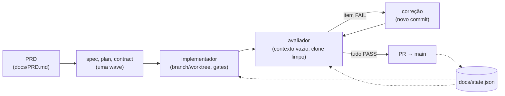

# Catraca

MVP de venda de ingressos para eventos pequenos, construído em modo agente: vitrine pública, contas, área do
organizador, compra com gateway de pagamento simulado (assíncrono), check-in, painel, cancelamento e API de parceiros.
Fonte da verdade: `docs/PRD.md`; estado das features: `docs/state.json`; instruções para agentes: `AGENTS.md`.

Enunciado do desafio: [Do brief ao produto em modo agente (Full Cycle)](https://plataforma.fullcycle.com.br/courses/a091b0fe-a5c6-4287-a3d3-1ec61defcfd3/413/224/266/conteudos?projeto=70&fase=311).

## Como rodar

Pré-requisitos: **Docker** (com Compose v2.17+) em execução, **Git** e **Node.js LTS** (22+). Não é preciso
`npm install` nem `.env`: o app e o Postgres rodam em containers; o Node do host só executa o `npm run e2e`.

```bash
git clone https://github.com/marcelojuca/mba-ia-desafio-do-brief-ao-produto-modo-agente catraca && cd catraca
./scripts/up.sh       # sobe banco + app (migra e roda a seed automaticamente)   — ou: npm run up
npm run e2e           # fluxo ponta a ponta do avaliador contra o ambiente de pé (~2 min)
./scripts/gates.sh    # sintaxe + testes automatizados em ambiente isolado         — ou: npm run gates
./scripts/down.sh     # derruba tudo (mantém os dados); --clean apaga o volume     — ou: npm run down
```

- `up.sh` espera o app ficar healthy (migrações + seed concluídas) e imprime `WEB`/`API`.
- `npm run e2e` (`scripts/e2e-flow.mjs`) executa os passos 2–16 do Fluxo do avaliador pela interface web (formulários
  HTTP com cookie) e pela API, no modo padrão do gateway (atrasos reais), imprimindo `✔ passo N — ...` por verificação;
  sai com código ≠ 0 no primeiro `✘`. É repetível (cada execução cria eventos e um participante novos). Variáveis:
  `WEB` (padrão `http://localhost:3000`), `API` (padrão = `WEB`), `KEY` (padrão `catraca-parceiro-dev`).
- `gates.sh` roda num projeto Compose separado (`catraca-gates`, banco próprio, sem portas no host, gateway acelerado
  com `GATEWAY_DELAY_SCALE=0.01`) e sempre limpa o que subiu; pode rodar com o ambiente principal de pé.

Porta ocupada ou outro ambiente de pé: `PORT=3100 COMPOSE_PROJECT_NAME=catraca-2 ./scripts/up.sh`
(e `COMPOSE_PROJECT_NAME=catraca-2 ./scripts/down.sh` para derrubar; no e2e, `WEB=http://localhost:3100 npm run e2e`).

## Endereços

```bash
WEB=http://localhost:3000
API=http://localhost:3000   # API de parceiros em $API/api/partner
```

| | URL |
|---|---|
| `$WEB` — vitrine, contas, área do organizador | http://localhost:3000 |
| `$API` — API de parceiros | http://localhost:3000/api/partner |
| Health | http://localhost:3000/health |

O Postgres não é exposto no host (acesso: `docker compose exec db psql -U catraca catraca`).

## Credenciais (seed)

| Papel | E-mail | Senha |
|---|---|---|
| Organizador A | `org.a@catraca.dev` | `catraca123` |
| Organizador B | `org.b@catraca.dev` | `catraca123` |
| Participante | `participante@catraca.dev` | `catraca123` |

Chave da API de parceiros (header `X-Api-Key`): **`catraca-parceiro-dev`** (`KEY=catraca-parceiro-dev`; variável
`PARTNER_API_KEY` no Compose).

Participantes também podem criar a própria conta em `/signup`. Organizadores existem só pela seed.

### Onde fica cada coisa na interface

- Vitrine (`/`): eventos publicados, vagas disponíveis e compra (participante logado; cartão de 16 dígitos).
- "Meus ingressos" (`/my-tickets`): evento, status e código de 8 caracteres de cada ingresso do participante.
- "Meus eventos" (`/organizer`): o organizador cria eventos (nascem rascunho) e abre a página de gestão
  `/organizer/events/:id`, que reúne edição, publicação, **Painel** (Confirmados, Pendentes, Check-ins, Vagas
  disponíveis, Receita, Estornados), **Check-in** por código e **Cancelar evento**. Cada organizador vê e opera só os
  próprios eventos.

Gateway simulado (final do cartão): `0001` aprova em 2–5 s; `0002` recusa em 2–5 s; `0003` aprova em 30–40 s;
`0004` recusa em 30–40 s; outros finais recusam em 2–5 s.

## API de parceiros

JSON em `/api/partner`, autenticada pelo header `X-Api-Key` (sem chave ou errada → `401 {"error":"unauthorized"}`).

```bash
API=http://localhost:3000; KEY=catraca-parceiro-dev
curl -s "$API/api/partner/events" -H "X-Api-Key: $KEY"
# → [{"id":"evt_...","name":"...","startsAt":"2026-12-05T21:00:00-03:00","priceCents":10000,"availableSeats":2}]
curl -s -X POST "$API/api/partner/events/<eventId>/purchases" -H "X-Api-Key: $KEY" \
  -H "Content-Type: application/json" -d '{"buyerEmail":"cliente@example.com","cardNumber":"4000000000000001"}'
# → 202 {"ticketId":"tkt_...","code":"K7Q2M9XA","status":"pending"} | 422 invalid_request | 404 event_not_available | 409 sold_out
curl -s "$API/api/partner/tickets/<ticketId>" -H "X-Api-Key: $KEY"
# → {"ticketId":"tkt_...","code":"...","eventId":"evt_...","status":"confirmed","checkedIn":false} | 404 ticket_not_found
```

Rajada de concorrência (evento novo com lotação 5 → `5 202` e `25 409`):

```bash
seq 30 | xargs -P 30 -I{} curl -s -o /dev/null -w "%{http_code}\n" -X POST "$API/api/partner/events/$E/purchases" \
  -H "X-Api-Key: $KEY" -H "Content-Type: application/json" \
  -d '{"buyerEmail":"carga{}@example.com","cardNumber":"4000000000000001"}' | sort | uniq -c
```

## Configuração

| Variável | Padrão | Uso |
|---|---|---|
| `PORT` | `3000` | porta publicada no host |
| `COMPOSE_PROJECT_NAME` | `catraca` | nome do projeto Compose (ambientes paralelos) |
| `PARTNER_API_KEY` | `catraca-parceiro-dev` | chave da API de parceiros |
| `GATEWAY_DELAY_SCALE` | `1` | multiplica os atrasos do gateway simulado (os testes usam `0.01`) |

## Mapa dos artefatos

| Artefato | Onde |
|---|---|
| PRD: features, dependências, waves, critérios de aceite e rastreabilidade R01–R13 | [`docs/PRD.md`](docs/PRD.md) |
| Estado de cada feature (status, PR, relatório mais recente) | [`docs/state.json`](docs/state.json) |
| Processo de avaliação independente, prompt do avaliador e template do relatório | [`docs/evaluation/`](docs/evaluation/) |
| Instruções para agentes (comandos, regras, pontos de extensão, fluxo de trabalho) | [`AGENTS.md`](AGENTS.md) (e [`CLAUDE.md`](CLAUDE.md), que aponta para ele) |
| Fluxo ponta a ponta do avaliador | [`scripts/e2e-flow.mjs`](scripts/e2e-flow.mjs) |

Cada feature tem uma pasta com `spec.md` (o quê), `plan.md` (etapas), `contract.md` (itens verificáveis usados pelo
avaliador) e `eval-report-*.md` (relatórios de avaliação, imutáveis):

| Feature | Pasta | Wave | PR |
|---|---|---|---|
| F01 Fundação, harness e contas | [`docs/features/F01-fundacao-contas/`](docs/features/F01-fundacao-contas/) | 1 | [#1](https://github.com/marcelojuca/mba-ia-desafio-do-brief-ao-produto-modo-agente/pull/1) |
| F02 Eventos do organizador e vitrine | [`docs/features/F02-eventos-vitrine/`](docs/features/F02-eventos-vitrine/) | 2 | [#2](https://github.com/marcelojuca/mba-ia-desafio-do-brief-ao-produto-modo-agente/pull/2) |
| F03 Compra de ingressos e gateway simulado | [`docs/features/F03-compra-gateway/`](docs/features/F03-compra-gateway/) | 3 | [#3](https://github.com/marcelojuca/mba-ia-desafio-do-brief-ao-produto-modo-agente/pull/3) |
| F04 API de parceiros | [`docs/features/F04-api-parceiros/`](docs/features/F04-api-parceiros/) | 4 (paralela) | [#4](https://github.com/marcelojuca/mba-ia-desafio-do-brief-ao-produto-modo-agente/pull/4) |
| F05 Check-in e painel | [`docs/features/F05-checkin-painel/`](docs/features/F05-checkin-painel/) | 4 (paralela) | [#6](https://github.com/marcelojuca/mba-ia-desafio-do-brief-ao-produto-modo-agente/pull/6) |
| F06 Cancelamento de evento | [`docs/features/F06-cancelamento/`](docs/features/F06-cancelamento/) | 4 (paralela) | [#5](https://github.com/marcelojuca/mba-ia-desafio-do-brief-ao-produto-modo-agente/pull/5) |
| F07 Integração ponta a ponta | [`docs/features/F07-integracao-e2e/`](docs/features/F07-integracao-e2e/) | 5 | [#7](https://github.com/marcelojuca/mba-ia-desafio-do-brief-ao-produto-modo-agente/pull/7) |

PRs da wave paralela (wave 4): [#4 — F04 API de parceiros](https://github.com/marcelojuca/mba-ia-desafio-do-brief-ao-produto-modo-agente/pull/4),
[#5 — F06 Cancelamento](https://github.com/marcelojuca/mba-ia-desafio-do-brief-ao-produto-modo-agente/pull/5),
[#6 — F05 Check-in e painel](https://github.com/marcelojuca/mba-ia-desafio-do-brief-ao-produto-modo-agente/pull/6).
As três branches foram implementadas ao mesmo tempo em worktrees separadas (`.worktrees/<feature>`); o primeiro commit de
cada uma (19:07:00–19:07:04) é anterior ao último commit das outras (19:08:50–19:10:03).

Correção pós-integração: [#8 — margem do cartão 0001](https://github.com/marcelojuca/mba-ia-desafio-do-brief-ao-produto-modo-agente/pull/8)
(atraso 2000–4000 ms, apontado pela avaliação de F07), reavaliado em F03.

Código: `src/` (um módulo por domínio — `auth`, `events`, `tickets`, `gateway`, `partner`, `checkin`, `panel`,
`cancellation`, `web`, `db`), testes em `test/` (`node:test`), scripts em `scripts/`.

## Decisões

### Stack e por quê

Node.js 22 (ESM, JavaScript puro, sem build), Express 4, PostgreSQL 16 e HTML renderizado no servidor (tagged template
que escapa tudo), tudo em Docker Compose. Runtime com só duas dependências (`express`, `pg`); testes com `node:test`,
sem dev-dependencies. Motivos: subir com um comando em qualquer máquina com Docker, nada para compilar nem instalar no
host, superfície pequena para agentes lerem e alterarem com segurança, e um banco com transações e locks de linha de
verdade — a regra mais crítica (R07) depende disso. Páginas com ganchos `data-*` estáveis permitem testar a interface
por HTTP puro (testes e `npm run e2e`), sem navegador.

### R07 — nunca vender além da lotação, sob concorrência

`purchaseTicket` (`src/tickets/purchase.js`), usada tanto pela vitrine quanto pela API, faz tudo numa transação:
`SELECT ... FROM events WHERE id = $1 FOR UPDATE` trava a linha do evento, conta as vagas ocupadas
(`pending` + `confirmed`), e só então insere o ingresso `pending` e a tentativa de pagamento. Compras concorrentes do
mesmo evento são serializadas nesse lock; a segunda só conta depois que a primeira comitou. O **mesmo lock** é usado
na edição (reduzir a lotação abaixo das vagas ocupadas é rejeitado dentro da transação, R03), na publicação e no
cancelamento, então nenhuma compra entra entre a checagem e a mudança. Provas: teste automatizado de 30 compras
simultâneas em lotação 5 (exatamente 5 sucessos, em 5 rodadas no serviço — `test/purchase.test.js` — e 5×202 +
25×409 em 2 rodadas pela API — `test/partner-api.test.js`), passo 15 do `npm run e2e` e a rajada `xargs -P 30` acima (`5 202` + `25 409`).

### Gateway assíncrono

A compra responde na hora com o ingresso `pending` (R06). A decisão do gateway simulado (aprovar/recusar pelo final do
cartão) e o instante da resposta são sorteados na compra e **persistidos** em `payment_attempts` (`outcome`,
`respond_at`) na mesma transação. Um worker em background (`src/gateway/worker.js`) roda a cada 200 ms e também num
timer agendado para o `respond_at` de cada compra; ele aplica as respostas vencidas com
`UPDATE tickets ... WHERE id = $1 AND status = 'pending'` (`FOR UPDATE SKIP LOCKED` nas tentativas). Consequências:
reiniciar o app não perde respostas; e uma resposta que chegue depois do cancelamento não muda nada, porque o ingresso
já não está `pending` (R08, R11). O cancelamento (`src/cancellation/service.js`) trava o evento e muda os ingressos
com **um único** `UPDATE` com `CASE` (`confirmed → refunded`, `pending → cancelled`): se o worker estiver confirmando
um pendente no mesmo instante, o `UPDATE` espera o lock da linha e reavalia com o valor novo, sem janela para um
pendente escapar como confirmado. `GATEWAY_DELAY_SCALE` acelera os atrasos só nos testes.

### O ciclo: implementar, avaliar, corrigir



| Papel | Lê | Escreve |
|---|---|---|
| Orquestrador (sessão principal) | Brief, R01–R13 | `docs/PRD.md`, `docs/state.json`; abre e integra os PRs |
| Autor da spec (orquestrador) | Seção da feature no PRD + código da `main` | `docs/features/FXX-*/spec.md`, `plan.md`, `contract.md` |
| Implementador (subagente) | spec, plan, contract, `AGENTS.md` | Código e testes, um commit `feat(FXX): <etapa>` por etapa do plano; `./scripts/gates.sh` verde |
| Avaliador (subagente novo) | Só `contract.md` + o sistema rodando | `eval-report-<timestamp>.md` novo, veredito por item com evidência |
| Correção | Relatório mais recente | Commit/PR de correção (ex.: [#8](https://github.com/marcelojuca/mba-ia-desafio-do-brief-ao-produto-modo-agente/pull/8)), seguido de nova avaliação |

O avaliador nunca vê o raciocínio do implementador, só o contrato e o sistema de pé. Essa separação é o ponto: o
contrato é o acordo entre o PRD e os agentes, e uma feature só vira `done` em `docs/state.json` com um relatório
aprovado.

### Avaliação isolada

Quem implementa nunca avalia. Cada feature foi avaliada por um **subagente novo do Claude Code, de contexto vazio**, a
partir de um clone limpo no commit avaliado (anotado no relatório), recebendo só a pasta da feature e as instruções de
`docs/evaluation/` — sem ver a conversa nem o raciocínio do implementador. O avaliador sobe o ambiente, roda os quality
gates e exercita cada item do `contract.md` com evidência (comando + resposta), gravando um `eval-report-<timestamp>.md`
**novo**; relatórios nunca são editados nem apagados (reprovou → corrige → nova avaliação, novo arquivo). O
orquestrador atualiza `docs/state.json` depois de cada relatório. Ver [`docs/evaluation/README.md`](docs/evaluation/README.md).

### Como as features foram entregues

Em waves definidas pelo grafo de dependências do PRD (§ 5), cada feature numa branch `feat/FXX-slug` com um commit
por etapa do `plan.md`, `./scripts/gates.sh` verde, avaliação independente aprovada e integração na `main` por PR:

1. **Wave 1** — F01 (fundação, harness, contas): PR #1.
2. **Wave 2** — F02 (eventos e vitrine): PR #2.
3. **Wave 3** — F03 (compra e gateway): PR #3.
4. **Wave 4 (paralela)** — F04, F05 e F06 ao mesmo tempo, uma worktree e um ambiente Compose isolado
   (`COMPOSE_PROJECT_NAME`/`PORT`/`GATES_PROJECT` próprios) por feature, sem se consumirem entre si; pontos de conflito
   antecipados no PRD (registro de rotas/seções e números de migração pré-alocados). PRs #4, #5 e #6.
5. **Wave 5** — F07 (este fluxo ponta a ponta e o README final) sobre a `main` integrada: a prova de que as features
   funcionam juntas no modo padrão do gateway.

Uma feature só começa quando todas as que ela consome estão `done` em `docs/state.json`.
