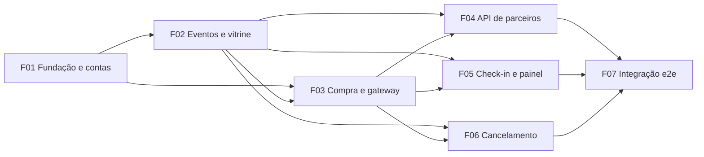

# PRD — Catraca (MVP)

> Fonte: brief da fundadora (regras R01–R13, gateway simulado e contrato fixo da API de parceiros).
> Este PRD é a fonte da verdade para as features, as dependências entre elas, as waves e os critérios de aceite.
> Specs, planos e contratos ficam em `docs/features/<FXX-slug>/`. O estado de cada feature fica em `docs/state.json`.

## 1. Visão

A Catraca vende ingressos para eventos pequenos (shows em bar, workshops, meetups). O MVP cobre: vitrine pública,
contas de participante, área do organizador (criar, editar, publicar, cancelar, check-in e painel), compra com gateway
de pagamento assíncrono simulado e uma API de parceiros com contrato fixo.

O risco central do produto é **integração**: cada feature funciona sozinha e quebra quando encontra as outras
(evento cancelado deixando gente entrar, estorno somado como receita, lotação estourada sob pico). Por isso, cada
dependência do grafo tem critério cross-feature (seção 6) e existe uma feature de integração ponta a ponta (F07).

## 2. Personas

| Persona | Como entra | O que faz |
|---|---|---|
| Visitante | sem login | vê a vitrine |
| Participante | cria a própria conta (nome, e-mail, senha) | entra, sai, compra ingressos, vê "Meus ingressos" |
| Organizador | conta criada pela seed (não se cadastra) | cria e opera os próprios eventos |
| Parceiro | chave `X-Api-Key` | lista eventos, compra e consulta ingressos pela API |

## 3. Glossário de status do ingresso

| Rótulo (UI) | Valor (API) | Quando |
|---|---|---|
| pendente | `pending` | compra criada, aguardando o gateway |
| confirmado | `confirmed` | gateway aprovou |
| recusado | `declined` | gateway recusou |
| cancelado | `cancelled` | estava pendente quando o evento foi cancelado |
| estornado | `refunded` | estava confirmado quando o evento foi cancelado |

Check-in não é status: é o campo `checkedIn` (coluna `checked_in_at`).

Status do evento: `draft` (rascunho) → `published` (publicado) → `cancelled` (cancelado, terminal).

## 4. Features

| ID | Nome | Wave | Consome | Pasta |
|---|---|---|---|---|
| F01 | Fundação, harness e contas | 1 | — | `docs/features/F01-fundacao-contas/` |
| F02 | Eventos do organizador e vitrine | 2 | F01 | `docs/features/F02-eventos-vitrine/` |
| F03 | Compra de ingressos e gateway simulado | 3 | F01, F02 | `docs/features/F03-compra-gateway/` |
| F04 | API de parceiros | 4 | F02, F03 | `docs/features/F04-api-parceiros/` |
| F05 | Check-in e painel | 4 | F02, F03 | `docs/features/F05-checkin-painel/` |
| F06 | Cancelamento de evento | 4 | F02, F03 | `docs/features/F06-cancelamento/` |
| F07 | Integração ponta a ponta | 5 | F04, F05, F06 | `docs/features/F07-integracao-e2e/` |

### F01 — Fundação, harness e contas

**Provê**
- `F01.P1` Harness: `./scripts/up.sh` (sobe tudo, com migração e seed), `./scripts/down.sh` (derruba tudo), `./scripts/gates.sh` (sintaxe + testes automatizados em ambiente isolado). Atalhos `npm run up|down|gates`.
- `F01.P2` Banco Postgres em container, runner de migrações SQL (`src/db/migrations/NNNN_*.sql`) e pool `db` (`src/db/pool.js`) com helper de transação.
- `F01.P3` Seed idempotente: organizador A, organizador B e participante (credenciais no README).
- `F01.P4` Contas: cadastro de participante, login, logout, sessão por cookie, `req.user` e os middlewares `requireLogin`, `requireRole('organizer'|'participant')`.
- `F01.P5` Servidor Express com layout HTML server-side (`render`), navegação por papel e `/health`.
- `F01.P6` Infra de testes (`node:test`) com banco de teste isolado e helpers (`test/helpers`).
- `F01.P7` `AGENTS.md` (porta de entrada dos agentes) e `CLAUDE.md` apontando para ele.

**Consome:** nada.

### F02 — Eventos do organizador e vitrine

**Provê**
- `F02.P1` Tabela `events` (`id` texto `evt_*`, `organizer_id`, `name`, `starts_at`, `venue`, `capacity`, `price_cents`, `status`) e o módulo `src/events/` com validação R01.
- `F02.P2` Área do organizador `/organizer` (lista dos próprios eventos), criação, edição e publicação.
- `F02.P3` Página de gestão `/organizer/events/:id` com ponto de extensão de seções (`registerManagementSection`) para check-in, painel e cancelamento, e o guard de propriedade `loadOwnedEvent` (R13).
- `F02.P4` Vitrine pública `/` listando apenas eventos `published`, e a função `listOnSaleEvents()`.
- `F02.P5` Ganchos de validação de edição (`registerEditValidator`) para que outras features validem mudanças (ex.: lotação vs. vagas ocupadas).

**Consome:** `F01.P2` (banco), `F01.P4` (sessão e papel de organizador), `F01.P3` (organizadores da seed), `F01.P5` (layout).

### F03 — Compra de ingressos e gateway simulado

**Provê**
- `F03.P1` Tabelas `tickets` (`id` `tkt_*`, `event_id`, `user_id` opcional, `buyer_email`, `code` único de 8 caracteres, `status`, `price_cents` do momento da compra, `channel` `web|partner`) e `payment_attempts`.
- `F03.P2` Serviço `purchaseTicket({ eventId, userId, buyerEmail, cardNumber, channel })` com a ordem de erros `invalid_request` → `event_not_available` → `sold_out`, garantindo R07 com lock da linha do evento.
- `F03.P3` Disponibilidade `getAvailability(eventId)` / `occupiedSeats` conforme R05 (cancelado → 0).
- `F03.P4` Gateway simulado (finais 0001–0004) e worker persistente que aplica a resposta só a ingressos ainda `pending`.
- `F03.P5` Compra na vitrine (formulário de cartão, "Ingressos esgotados") e página "Meus ingressos".
- `F03.P6` Validação de edição de lotação (R03) registrada no gancho `F02.P5`.
- `F03.P7` `getTicketById(id)` e `ticketStatusLabel(status)`.

**Consome:** `F01.P4` (participante logado), `F02.P1`/`F02.P4` (eventos publicados, preço, lotação), `F02.P5` (gancho de edição).

### F04 — API de parceiros

**Provê:** `F04.P1` rotas `/api/partner/events`, `/api/partner/events/{id}/purchases`, `/api/partner/tickets/{id}` com o contrato fixo do brief; `F04.P2` middleware `X-Api-Key` (chave por `PARTNER_API_KEY`, padrão documentado no README).

**Consome:** `F02.P4` (`listOnSaleEvents`), `F03.P2` (`purchaseTicket` com `channel: 'partner'`), `F03.P3` (vagas), `F03.P7` (consulta de ingresso).

### F05 — Check-in e painel

**Provê:** `F05.P1` seção de check-in na página de gestão com as mensagens exatas de R10; `F05.P2` seção de painel com Confirmados, Pendentes, Check-ins, Vagas disponíveis, Receita e Estornados (R12); coluna `tickets.checked_in_at`.

**Consome:** `F02.P3` (página de gestão e guard de propriedade), `F03.P1` (ingressos, status e preço pago), `F03.P3` (vagas disponíveis).

### F06 — Cancelamento de evento

**Provê:** `F06.P1` ação de cancelar na página de gestão (irreversível; bloqueia edição e republicação); `F06.P2` transição em transação: `confirmed → refunded`, `pending → cancelled`; `F06.P3` coluna `events.cancelled_at`.

**Consome:** `F02.P3` (página de gestão, guard e edição), `F02.P1` (status do evento), `F03.P1`/`F03.P4` (ingressos e worker que só altera `pending`).

### F07 — Integração ponta a ponta

**Provê:** `F07.P2` README final (seções exigidas no entregável); `F07.P1` script `npm run e2e` (`scripts/e2e-flow.mjs`) que executa os passos 2–16 do Fluxo do avaliador contra o ambiente de pé, pela interface web (formulários HTTP com cookie) e pela API, no modo padrão do gateway.

**Consome:** `F04.P1`, `F05.P1`/`F05.P2`, `F06.P1`/`F06.P2` (e, transitivamente, F01–F03).

## 5. Grafo de dependências e waves

Arestas (consumidor ← provedor): F02←F01, F03←F01, F03←F02, F04←F02, F04←F03, F05←F02, F05←F03, F06←F02, F06←F03, F07←F04, F07←F05, F07←F06.

| Wave | Features | Execução |
|---|---|---|
| 1 | F01 | sequencial |
| 2 | F02 | sequencial |
| 3 | F03 | sequencial |
| 4 | F04, F05, F06 | **paralela** — uma branch/worktree por feature, integradas por PR |
| 5 | F07 | sequencial, sobre a main integrada |

Regra de ouro do handoff: uma feature só começa quando todas as que ela consome estão `done` em `docs/state.json`
(relatório de avaliação mais recente aprovando tudo). Na wave 4, as três features não se consomem entre si; a
integração entre elas é coberta por F07.

Pontos de conflito esperados na wave 4: registro de rotas/seções (`src/app.js`, `src/events/management-sections.js`)
e o número das migrações (pré-alocados: F05 = `0005`, F06 = `0006`; F04 não cria migração).

## 6. Critérios de aceite

Formato: `ID` — critério (regras citadas). Os critérios `CF-*` são cross-feature: cada um comprova que o que uma
feature provê chega e funciona na que consome.

### F01 — Fundação, harness e contas
- `F01-AC01` — Em um clone limpo, `./scripts/up.sh` deixa o produto acessível em `http://localhost:3000` com a seed carregada, sem nenhum outro passo.
- `F01-AC02` — `./scripts/down.sh` encerra tudo que a subida iniciou (nenhuma porta do produto responde, nenhum container do projeto rodando); subir de novo funciona, inclusive a seed.
- `F01-AC03` — `./scripts/gates.sh` roda checagem de sintaxe e testes automatizados e passa.
- `F01-AC04` — Visitante cria conta de participante (nome, e-mail, senha), entra e sai; e-mail duplicado ou campos inválidos são rejeitados; o cadastro nunca cria organizador.
- `F01-AC05` — A seed cria organizador A, organizador B e participante; pode rodar de novo sem erro; as credenciais do README funcionam.
- `F01-AC06` — `AGENTS.md` na raiz traz os comandos de subir, derrubar e gates, as regras do projeto e o mapa dos artefatos; `CLAUDE.md` aponta para ele.

### F02 — Eventos do organizador e vitrine
- `F02-AC01` — Organizador cria evento com nome, data/hora de início, local, lotação (inteiro ≥ 1) e preço em reais (> 0); valores inválidos e data de início no passado são rejeitados, na criação e na edição (R01).
- `F02-AC02` — Todo evento nasce rascunho e fica fora da vitrine; publicado aparece na vitrine (R02).
- `F02-AC03` — Cada evento tem página de gestão com URL própria (`/organizer/events/:id`) onde o organizador edita e publica (R04).
- `F02-AC04` — Na área de organizador, cada organizador só vê e opera os próprios eventos: a lista não mostra eventos de outro e a URL direta de evento de outro não exibe nenhum dado dele; participante e visitante não acessam a área (R13).
- `F02-AC05` — Edição de preço e aumento de lotação são aceitos (R03).
- `CF-01` (F01→F02) — Os organizadores A e B da seed de F01 entram com as credenciais do README e chegam à própria área; o participante da seed (sessão de F01) é barrado na área de organizador (R13).

### F03 — Compra de ingressos e gateway simulado
- `F03-AC01` — Participante logado compra um ingresso na vitrine: a compra nasce `pending`, ocupa vaga e é respondida sem esperar o gateway; com cartão final 0001 fica `confirmed` em até 5 s (R06, R08).
- `F03-AC02` — "Meus ingressos" mostra, para cada ingresso do participante, o evento, o rótulo do status e o código único de 8 caracteres (R09).
- `F03-AC03` — Ingresso pendente ocupa vaga até a resposta do gateway; recusa (0002, 0004, outros finais) deixa `declined` e libera a vaga (R05, R08).
- `F03-AC04` — Sem vaga, a compra é recusada: a vitrine mostra "Ingressos esgotados" no lugar da compra e como resposta à tentativa; o serviço retorna `sold_out` (R07).
- `F03-AC05` — Sob compras simultâneas as vagas ocupadas nunca passam da lotação: 30 compras simultâneas em evento de lotação 5 resultam em exatamente 5 sucessos, de forma repetível (R07).
- `F03-AC06` — Gateway simulado responde conforme o final do cartão (0001/0002 em 2–5 s, 0003/0004 em 30–40 s, outros recusados em 2–5 s); cartão sem 16 dígitos é rejeitado antes de criar ingresso; o modo padrão não exige nenhuma chave; o atraso só é configurável por variável de ambiente para testes.
- `F03-AC07` — Vagas disponíveis = lotação − (pendentes + confirmados); em evento cancelado, zero (R05).
- `F03-AC08` — Reduzir a lotação abaixo das vagas ocupadas é rejeitado; mudança de preço vale só para compras posteriores (cada ingresso guarda o preço pago) (R03).
- `CF-02` (F01→F03) — Participante criado pelo cadastro de F01 compra na vitrine e vê em "Meus ingressos" só os próprios ingressos; visitante sem sessão não compra (R06, R09).
- `CF-03` (F02→F03) — Evento criado e publicado pela área de F02 aparece na vitrine com o formulário de compra; evento em rascunho não é comprável (`event_not_available`); após editar o preço na página de gestão de F02, a nova compra guarda o novo preço e as anteriores mantêm o antigo (R02, R03).
- `CF-04` (F02→F03) — Na página de gestão de F02, reduzir a lotação abaixo das vagas ocupadas por ingressos de F03 é rejeitado com mensagem; aumentar é aceito (R03, R05).

### F04 — API de parceiros
- `F04-AC01` — Sem `X-Api-Key` ou com chave inválida, as três rotas respondem 401 `{"error":"unauthorized"}`.
- `F04-AC02` — `GET /api/partner/events` lista só eventos publicados e não cancelados, com `id`, `name`, `startsAt` (ISO 8601 com offset), `priceCents` e `availableSeats` (R02, R05).
- `F04-AC03` — `POST /api/partner/events/{id}/purchases` responde 202 `{ticketId, code, status:"pending"}`; erros na ordem: 422 `invalid_request` (campo faltando, e-mail mal formado, cartão sem 16 dígitos) → 404 `event_not_available` (inexistente, rascunho ou cancelado) → 409 `sold_out` (R06, R07).
- `F04-AC04` — Em duas rodadas, cada uma em evento novo com lotação 5, 30 compras simultâneas pela API resultam em exatamente 5 respostas 202 e 25 respostas 409 (R07).
- `F04-AC05` — `GET /api/partner/tickets/{id}` responde 200 `{ticketId, code, eventId, status, checkedIn}` para ingresso de qualquer canal; inexistente → 404 `ticket_not_found` (R09).
- `CF-05` (F02→F04) — Evento publicado pela área de F02 aparece na listagem da API com `availableSeats` igual à lotação e `priceCents` igual ao preço; rascunho não aparece e compra nele responde 404 `event_not_available` (R02).
- `CF-06` (F03→F04) — Compra pela API usa o serviço de F03: ocupa vaga (`availableSeats` cai), o worker do gateway confirma/recusa e a consulta reflete; ingresso comprado na vitrine é consultável pela API; vagas ocupadas pela vitrine fazem a API responder 409 `sold_out` (R05, R06, R07, R08).

### F05 — Check-in e painel
- `F05-AC01` — No check-in, o organizador informa um código e a primeira situação verdadeira define a mensagem: código inexistente ou de outro evento → "Ingresso inválido para este evento"; evento cancelado → "Evento cancelado"; ingresso não confirmado → "Ingresso não confirmado"; já usado → "Ingresso já utilizado"; senão → "Entrada liberada" (R10).
- `F05-AC02` — O painel mostra Confirmados (inclui os com check-in), Pendentes, Check-ins (confirmados com check-in), Vagas disponíveis (R05), Receita e Estornados, contando vitrine e API (R12).
- `F05-AC03` — A Receita soma o preço pago por ingresso confirmado, com o preço vigente no momento de cada compra; estornados não entram na receita (R03, R12).
- `F05-AC04` — Check-in simultâneo do mesmo código libera a entrada uma única vez (R10).
- `CF-07` (F02→F05) — Check-in e painel aparecem na página de gestão de F02 e respeitam o guard de propriedade: organizador B não vê o painel de evento de A pela URL direta e não faz check-in nele (R04, R13).
- `CF-08` (F03→F05) — Ingressos criados pelo serviço de F03 (canais `web` e `partner`) entram no painel e no check-in: confirmado pelo gateway → "Entrada liberada"; pendente ou recusado → "Ingresso não confirmado"; estornado conta em Estornados e não em Receita (R10, R12).

### F06 — Cancelamento de evento
- `F06-AC01` — Só evento publicado pode ser cancelado; o cancelamento é irreversível: depois dele o evento não pode ser editado nem republicado, pela interface e pelo servidor (R11).
- `F06-AC02` — Evento cancelado sai da vitrine, não vende mais (compra retorna `event_not_available`) e tem zero vagas disponíveis (R02, R05, R11).
- `F06-AC03` — Em até 10 segundos do cancelamento, confirmados passam a `refunded` e pendentes a `cancelled` (R11).
- `F06-AC04` — Resposta do gateway que chegue depois do cancelamento não muda o status de nenhum ingresso (R08, R11).
- `CF-09` (F02→F06) — A ação de cancelar está na página de gestão de F02, só funciona para o dono do evento e, depois dela, a página não permite editar (R04, R11, R13).
- `CF-10` (F03→F06) — Ingressos de F03 (vitrine e canal `partner`) sofrem as transições do cancelamento; o worker do gateway de F03 que responde depois mantém `cancelled`/`refunded` (R08, R11).

### F07 — Integração ponta a ponta
- `F07-AC01` — `npm run e2e`, com o ambiente de pé e no modo padrão do gateway, executa os passos 2–16 do Fluxo do avaliador (web + API) e termina com sucesso, imprimindo cada verificação.
- `F07-AC02` — O README tem as seções Como rodar, Endereços, Credenciais, Mapa dos artefatos (com os links dos PRs da wave paralela) e Decisões (stack, R07 sob concorrência, gateway assíncrono, isolamento da avaliação).
- `CF-11` (F04→F07) — Compras feitas pela API (F04) contam na lotação, no painel, no check-in e no cancelamento exatamente como as da vitrine, verificadas no fluxo (R05, R07, R10, R11, R12).
- `CF-12` (F05→F07) — No fluxo, o painel de E1 mostra Confirmados 3, Pendentes 0, Check-ins 0, Vagas 0, Receita R$ 350,00, Estornados 0 e, após o check-in, Check-ins 1; as mensagens de check-in saem na ordem de R10, inclusive código de evento de outro organizador (R03, R10, R12, R13).
- `CF-13` (F06→F07) — No fluxo, E3 cancelado sai da vitrine e da API (404 `event_not_available`), T6 vira `refunded` e T5 `cancelled` em até 10 s e continua `cancelled` após 45 s; C6 no check-in → "Evento cancelado"; painel de E3 com Estornados 1 e Receita R$ 0,00 (R10, R11, R12).

### Rastreabilidade das regras

| Regra | Critérios |
|---|---|
| R01 | F02-AC01 |
| R02 | F02-AC02, F04-AC02, CF-03, CF-05, F06-AC02 |
| R03 | F02-AC05, F03-AC08, CF-03, CF-04, F05-AC03, CF-12 |
| R04 | F02-AC03, CF-07, CF-09 |
| R05 | F03-AC03, F03-AC07, CF-04, F04-AC02, CF-06, F06-AC02, CF-11 |
| R06 | F03-AC01, CF-02, F04-AC03, CF-06 |
| R07 | F03-AC04, F03-AC05, F04-AC03, F04-AC04, CF-06, CF-11 |
| R08 | F03-AC01, F03-AC03, CF-06, F06-AC04, CF-10 |
| R09 | F03-AC02, CF-02, F04-AC05 |
| R10 | F05-AC01, F05-AC04, CF-08, CF-11, CF-12, CF-13 |
| R11 | F06-AC01..AC04, CF-09, CF-10, CF-11, CF-13 |
| R12 | F05-AC02, F05-AC03, CF-08, CF-11, CF-12, CF-13 |
| R13 | F02-AC04, CF-01, CF-07, CF-09, CF-12 |

### Cobertura das arestas por critério cross-feature

| Aresta | Critério |
|---|---|
| F01→F02 | CF-01 |
| F01→F03 | CF-02 |
| F02→F03 | CF-03, CF-04 |
| F02→F04 | CF-05 |
| F03→F04 | CF-06 |
| F02→F05 | CF-07 |
| F03→F05 | CF-08 |
| F02→F06 | CF-09 |
| F03→F06 | CF-10 |
| F04→F07 | CF-11 |
| F05→F07 | CF-12 |
| F06→F07 | CF-13 |

## 7. Requisitos não funcionais

- Sobe com um comando, sem chave de pagamento real; apenas Docker, Git e Node.js LTS na máquina.
- R07 garantida no banco (lock da linha do evento dentro da transação de compra), não em memória.
- A resposta do gateway é persistida (`payment_attempts.respond_at`) e aplicada por um worker; reinício do processo não perde respostas pendentes.
- Datas exibidas e aceitas no fuso `America/Sao_Paulo` (−03:00).

## 8. Fora de escopo

- Deploy e qualquer ambiente além do local.
- Gateway de pagamento real, e-mail e notificações.
- App mobile e qualidade visual (nenhum critério avalia design).
- Cadastro de organizador pelo produto.
- Mais de um ingresso por compra, mapa de assentos, cancelamento ou transferência de ingresso pelo participante.
- Atualização em tempo real (recarregar a página basta).
- Fuso horário configurável; recuperação de senha; edição de perfil; paginação.
- Webhooks para parceiros e múltiplas chaves de parceiro.
